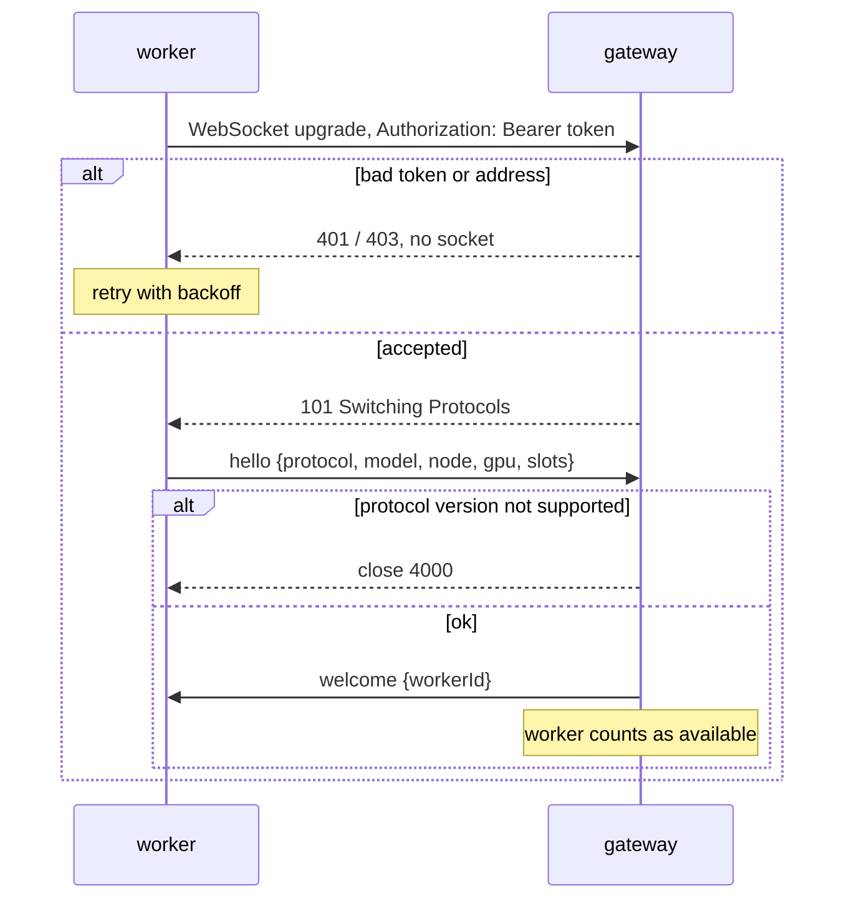
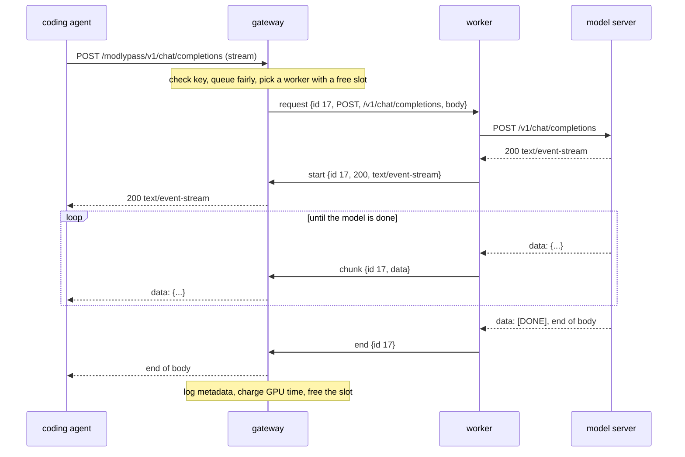
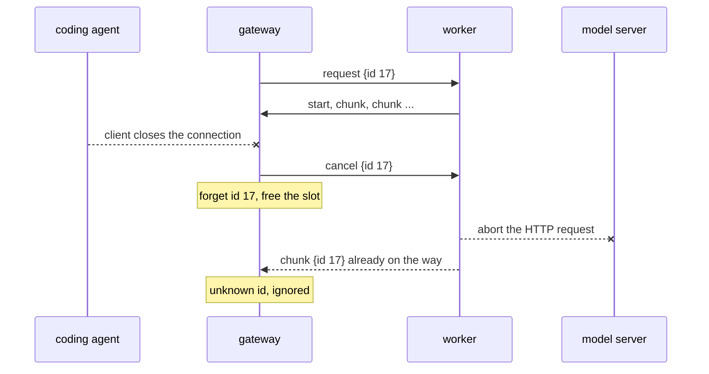
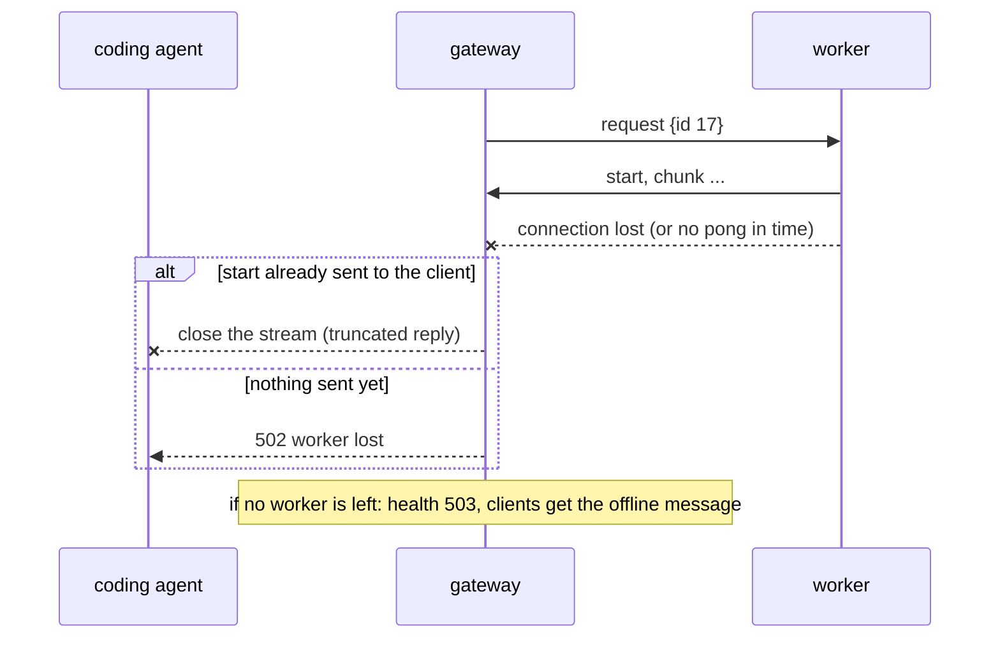
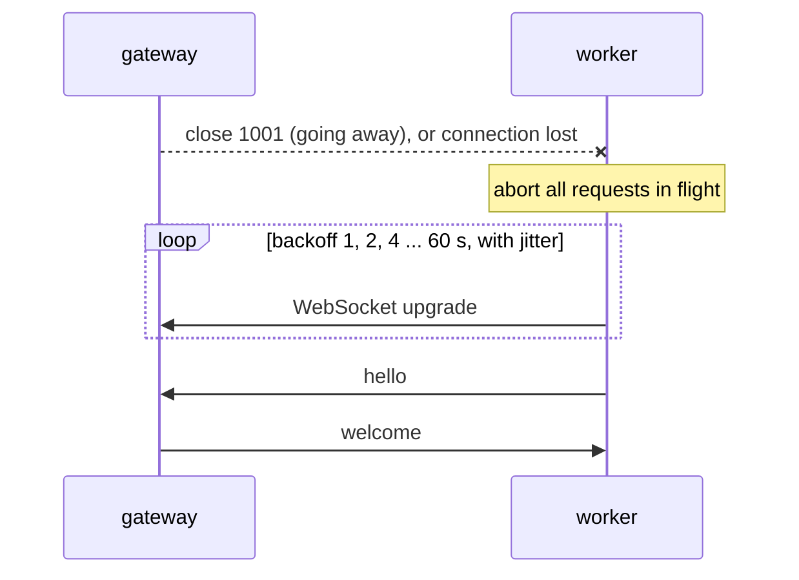
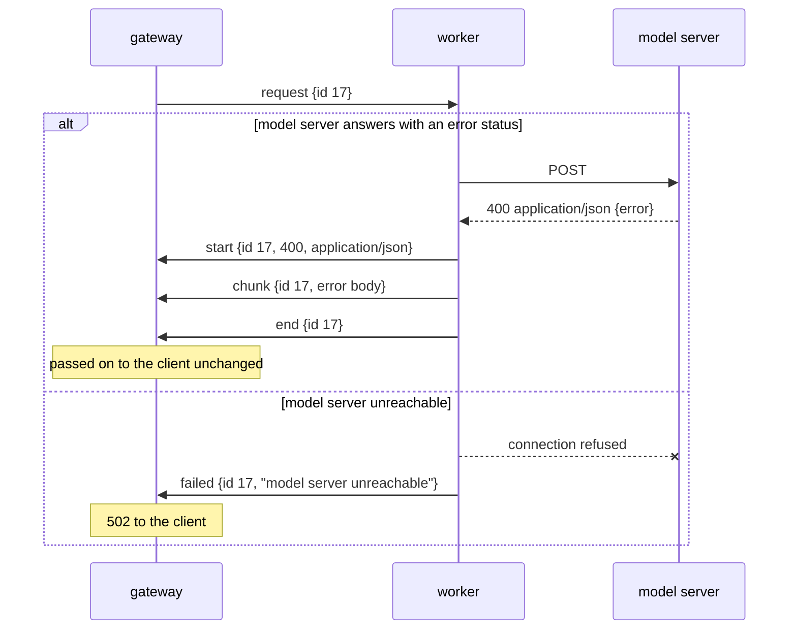

# modlypass worker protocol

**Status: draft, protocol version 1.** Not implemented yet.

> **TODO:** Björn to review this draft. Comments from LUNARC staff are welcome but not expected.

This is how a **worker** (running in a batch job on an HPC GPU node, next to the model server)
talks to the **gateway** (where students' coding agents connect). The worker opens the
connection, from the HPC centre to the gateway, so the gateway needs no login at the HPC centre
and the GPU nodes need no open ports.

```
coding agent ──HTTPS──▶ gateway ◀──WebSocket (wss)── worker ──HTTP──▶ model server (Ollama, vLLM)
  (student)                         opened by the worker     loopback on the GPU node
```

## Transport

- The worker connects to `wss://<gateway>/modlypass/worker` (WebSocket, RFC 6455), normally
  through the department's reverse proxy, which terminates TLS.
- **Authentication is done before the WebSocket opens:** the upgrade request carries
  `Authorization: Bearer <worker token>`. A missing or unknown token gives `401`, a source address
  outside the allowed ranges gives `403`, and no socket is opened.
- Every message is one UTF-8 **text frame** holding one JSON object. The field `type` says which
  message it is. Binary frames are a protocol error.
- Unknown fields are ignored, so a newer peer may add fields without breaking an older one.
  An unknown `type` is a protocol error.

## Messages

Request ids are positive integers chosen by the gateway, unique within one connection.

### Gateway → worker (`ToWorker`)

| `type` | Fields | Meaning |
|---|---|---|
| `welcome` | `workerId` (string) | The `hello` was accepted. Requests may follow. |
| `request` | `id`, `method` (string), `path` (string), `body` (JSON, `null` for none) | Forward this request to the model server. `path` starts with `/v1/`. |
| `cancel` | `id` | The client went away. Stop the request and send nothing more for it. |

### Worker → gateway (`ToGateway`)

| `type` | Fields | Meaning |
|---|---|---|
| `hello` | `protocol` (int), `model` (string), `node` (string), `gpu` (string), `slots` (int) | First message. `slots` is how many requests the worker takes at once. |
| `start` | `id`, `status` (int), `contentType` (string) | The model server answered with this status and content type. Sent once, before any `chunk`. |
| `chunk` | `id`, `data` (string) | The next piece of the response body, passed on unchanged (for streaming: server-sent-event lines). |
| `end` | `id` | The response body is complete. |
| `failed` | `id`, `message` (string) | The request could not be completed (model server unreachable, connection lost). |

`node` and `gpu` are for the admin's log and status view. The public health endpoint does not
show them.

### Examples

```json
{"type":"hello","protocol":1,"model":"qwen3-coder:30b","node":"gpu07","gpu":"NVIDIA A100-PCIE-40GB","slots":4}
{"type":"welcome","workerId":"w1"}
{"type":"request","id":17,"method":"POST","path":"/v1/chat/completions","body":{"model":"qwen3-coder:30b","stream":true,"messages":[{"role":"user","content":"Hi"}]}}
{"type":"request","id":18,"method":"GET","path":"/v1/models","body":null}
{"type":"start","id":17,"status":200,"contentType":"text/event-stream"}
{"type":"chunk","id":17,"data":"data: {\"choices\":[{\"delta\":{\"content\":\"Hello\"}}]}\n\n"}
{"type":"end","id":17}
{"type":"cancel","id":17}
{"type":"failed","id":17,"message":"model server unreachable"}
```

## Sequences

### 1. Connect



### 2. A streamed request



Non-streamed requests and `GET /v1/models` follow the same sequence, usually with a single `chunk`.

### 3. The student cancels



### 4. The worker disappears (job ends, node fails)



### 5. The gateway restarts



### 6. The model server fails



## Rules

1. The worker sends `hello` within 10 seconds of the socket opening, otherwise the gateway
   closes with 1008. The gateway sends no `request` before `welcome`.
2. The gateway never has more than `slots` requests in flight on one worker.
3. For each id the worker sends `start`, then any number of `chunk`, then `end`; or `failed` at
   any point instead of `end`. After `start` the HTTP status is already on its way to the client,
   so a later `failed` can only cut the reply short.
4. After `cancel` the gateway forgets the id. Messages that arrive later for an unknown id are
   ignored, and so is `cancel` for an id the worker does not know.
5. Heartbeat: the gateway sends a WebSocket ping every 20 seconds. If the gateway gets no pong
   within 60 seconds it treats the worker as lost (sequence 4). If the worker sees no ping for
   60 seconds it closes and reconnects (sequence 5).
6. Size limit: 16 MiB per message (requests with a 64k-token context are a few hundred kB).
   Larger messages are closed with 1009.
7. Neither side logs message contents (prompts, code, replies). Logs hold ids, sizes, times and
   status codes only.

### Close codes

| Code | Meaning |
|---|---|
| 1000 | Normal close (worker shutting down at the end of its job). |
| 1001 | Going away (gateway restarting). |
| 1002 | Protocol error: bad JSON, unknown `type`, binary frame, message out of order. |
| 1008 | Policy violation, for example no `hello` in time. |
| 1009 | Message too big. |
| 4000 | Protocol version not supported; the reason text names the versions the gateway accepts. |

## Scala data model

Both sides share one source file, `protocol/Protocol.scala`, with one enum per direction so that
the compiler stops a side from sending the other side's messages. Wire names are given
explicitly with `@key`, so renaming a Scala case cannot change the protocol. Tests check every
example above in both directions.

```scala
import upickle.default.*
import upickle.implicits.key

object Protocol {
  type RequestId = Long
  val Version = 1

  @key("type")
  enum ToWorker derives ReadWriter:
    @key("welcome") case Welcome(workerId: String)
    @key("request") case Request(id: RequestId, method: String, path: String, body: ujson.Value)
    @key("cancel")  case Cancel(id: RequestId)

  @key("type")
  enum ToGateway derives ReadWriter:
    @key("hello")  case Hello(protocol: Int, model: String, node: String, gpu: String, slots: Int)
    @key("start")  case Start(id: RequestId, status: Int, contentType: String)
    @key("chunk")  case Chunk(id: RequestId, data: String)
    @key("end")    case End(id: RequestId)
    @key("failed") case Failed(id: RequestId, message: String)
}
```
